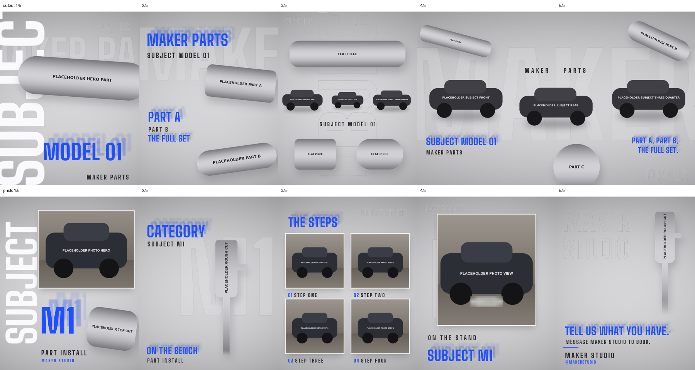
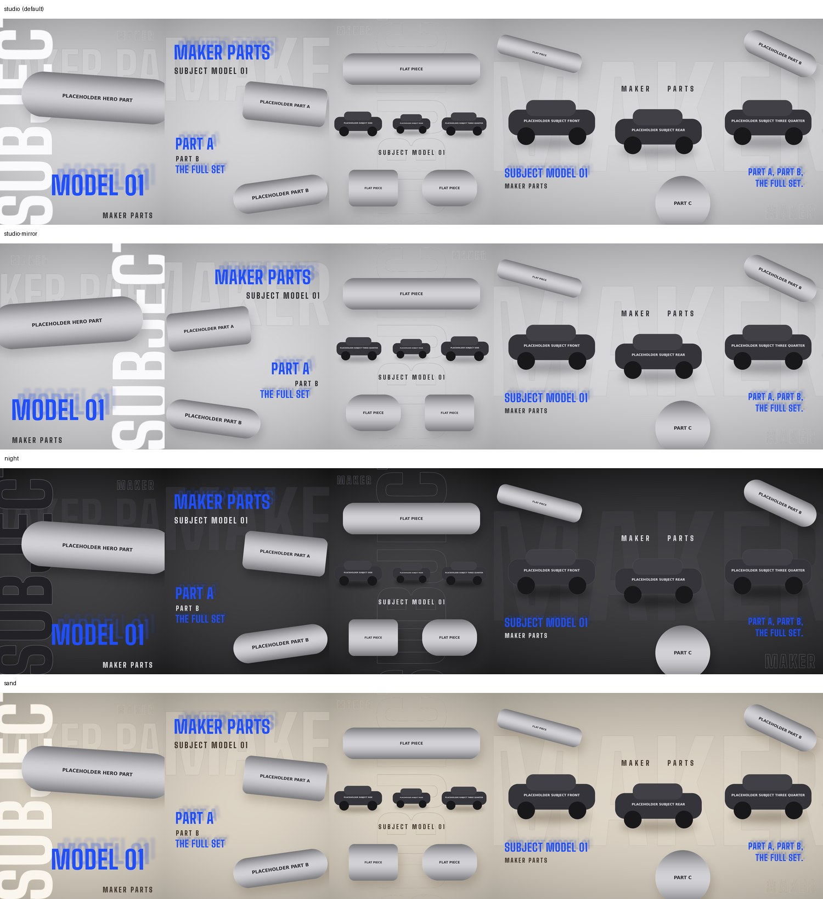

# Studio carousel

Omarie, 13 Oct 2026, on the carousel generator built for the Formula Dynamics x RYFT Ferrari 812 GTS carousel: "this
carousel generator why isnt it on my os". This is that generator, made generic.

It builds a 5-slide 4:5 Instagram carousel (1080x1350 per slide) in the studio look: product parts and subject renders
on a light grey seamless backdrop, with big type behind them. Everything brand-specific (colour, font, words, images,
placements) comes from a JSON spec. This folder holds the code and a sample spec with labelled placeholder images only.
Real photos, renders, client names and words never go in this public repo.

The approved layout rules (the look, the five slides, the margins, plates and faces, the checks) are in
[LAYOUT.md](LAYOUT.md). Read them before building one.

There are two builds. The **cutout build** (the default) uses product cutouts and studio renders, with slides 4 and
5 as one spread. The **photo build** uses real photos in clean frames, with a 2x2 grid of numbered steps on slide 3.



## Variations

The light grey studio look is the default. Omarie, 13 Oct 2026: "it should offer different variations as well but
this is one of my new favorites ones so this can be default". A variation is a theme plus a layout:

| Variation | Theme | Layout | Looks like |
|---|---|---|---|
| `studio` (default) | studio | default | light grey seamless, dark ink |
| `studio-mirror` | studio | mirror | the same look with slides 1 to 3 flipped left to right |
| `night` | night | default | charcoal studio, light ink, deeper shadows |
| `sand` | sand | default | warm off-white studio, brown ink |

The mirror layout leaves the 4–5 spread alone so it still reads across the swipe. Set `"theme"` and `"layout"` in
the spec, or pass `--variations` to render every variation into `out/<name>/` with one sheet of them all
(`out/variations.jpg`), so Omarie can pick:

```bash
python3 generate.py spec.json out/ --variations
python3 qa.py spec.json out/ --variations
```



## Files

| File | What it is |
|---|---|
| `LAYOUT.md` | The approved layout rules |
| `generate.py` | The generator: `python3 generate.py <spec.json> <out_dir> [--variations]`. Holds both builds' layouts |
| `photos.py` | The real-photo helpers: `photo()`, `redact()`, `cover()`, `panel()`, `clean_cut()` and `make_cuts()` |
| `engine.py` | The engine: a folder of photos and a words file in, five checked slides and one contact sheet out (below) |
| `finder.py` | Proposes plate boxes and finds faces for the engine. Local only: OpenCV, nothing generated |
| `finder_test.py` | Measures how often the finder misses a drawn plate |
| `qa.py` | The check to run before anything goes to nq-check (below) |
| `sheet.py` | One contact sheet of the slides: `python3 sheet.py out.jpg 1/5=01.png 2/5=02.png ...` |
| `sample/spec.json` | The cutout build's sample spec. Copy it to start a new carousel |
| `sample/photo_spec.json` | The photo build's sample spec |
| `sample/words.json` | The engine's sample words file |
| `sample/broken_spec.json` | Broken on purpose, for `python3 qa.py --selftest` |
| `sample/assets/` | Labelled placeholder parts, subjects and photos; `sample/make_placeholders.py` redraws them |
| `preview.png` | Both samples, rendered |
| `variations.jpg` | The cutout sample in every variation |

Needs Python 3 with numpy, Pillow and scipy (`pip install numpy pillow scipy`). On Omarie's Mac, run
it through uv: `uv run --with numpy --with pillow --with scipy python qa.py`. Cutting parts out of photos
(`photos.py cuts`) also needs rembg.

## The engine

One command builds the photo build from a folder of photos and a words file:

```
python3 engine.py <photo folder> --words words.json --out out/ [--mockup]
python3 engine.py --approve out/
```

On Omarie's Mac: `uv run --with numpy --with pillow --with scipy --with opencv-python-headless python engine.py ...`
(add `--with rembg` when it has to cut a part out of a photo). Try it on the sample:
`engine.py sample/assets --words sample/words.json --out out/`.

What it does, in order:

1. **Reads the words file.** It needs all 18 word roles (see `sample/words.json`) and the brand colour and font.
   Words on the slides come only from this file, and the engine writes them to the spec's `allowed_words`.
2. **Picks the photos.** Six photos: the hook, the large photo and the four steps. A name helps (`hero`, `view`,
   `step1` to `step4`); without names it uses the photo's shape, then name order. Cutout PNGs in the folder are
   used as the parts. `"pick": {"hero": "IMG_1.jpg", ...}` in the words file pins any slot.
3. **Looks for plates and faces** in every photo (`finder.py`), covers each plate it finds and crops each face
   out. It writes what it found to the photo's `redact` list in the spec, marked `proposed`.
4. **Writes `out/spec.json`, builds the five slides and runs `qa.py`'s checks.**
5. **Writes `out/sheet.jpg`**: the five slides, and under them every photo as it went in, with an outline where
   a cover was applied (red: plate, amber: plate it is unsure of, blue: face, green: the crop that removes it).

It prints `all clear` when the slides pass, then `NOT APPROVED YET`. It stops with `STOPPED:` and one plain line
when something is wrong: a word role missing, a word that isn't on the words file's own `allowed_words`, too few
photos, or a check that fails.

**A person approves the plates on the finished sheet.** Nothing is final until someone has looked at
`out/sheet.jpg` and run `engine.py --approve out/`, which writes `out/final/`. It refuses when the slides have
changed since the sheet was made. `"photos": {"IMG_1.jpg": {"redact": [[x0, y0, x1, y1]], "crop": [...]}}` in
the words file sets a photo's boxes by hand; the finder is then skipped for that photo.

**The finder misses plates, so "none found" is not a pass.** Measured 13 Oct 2026 with `finder_test.py` on 240
drawn plates: it missed 21 (9%): 0 of 80 near, 2 of 80 middle, 19 of 80 far (a plate under 5% of the photo's
width). It also covered something on 28 of 80 scenes with no plate; that costs a blurred patch, and 11 of those
were flagged as unsure. Drawn plates are easier than real ones, so expect it to miss more on real photos. It has
not been measured on real photos yet.

`--mockup` also writes `out/mockup/`, the sample as a page built from `../post-mockup/template.html`; it needs a
`post` block in the words file (title, sub, handle, caption, name). Run `../post-mockup/qa.js` on it before
publishing.

## The rules

1. **Ask which style first.** This is one look among the approved ones, so ask Omarie before building (CLAUDE.md,
   rule 1). Build it only when he picks it.
2. **Use the images we have.** Cut parts out of the product photos already supplied, and use the subject renders
   already made. Don't generate more unless Omarie asks; his words: "no more generating, use what we have".
3. **Every word is on the allowed list.** Put each word the slides may carry in the spec's `allowed_words`, taken from
   the brief or the client's own copy. `qa.py` fails on anything else. Before delivery the words go through nq-facts,
   then nq-second.
4. **One contact sheet to nq-check.** Make it with `sheet.py` and send that one image, never the slides one by one.
5. **Show it on the post mockup page** (`design-systems/post-mockup/`): the five slides in the Instagram frame beside
   the posting kit.
6. **One brand per carousel**, in that workstream's colour and font. Formula Dynamics is FD red `#FE0F13` with Bebas
   Neue; other workstreams take theirs from their brand spec.

## The design

- **Backdrop.** A light grey seamless studio: bright in the centre, darker at the top and the edges.
- **Cover (slide 1).** A huge vertical word down the left edge, white with a light outline and bleeding off the
  frame. The hero part floats large across the middle, the model name stacks bottom right in the brand colour, and
  the product name sits under it in dark ink.
- **Background type.** Ghost words (outline only) and faint filled words sit behind everything. They may bleed off
  the frame.
- **Headlines.** The brand colour, each with a blurred echo of itself above and to the right.
- **Labels.** Dark ink, widely letter-spaced.
- **Parts.** Product photos cut out with rembg (`isnet-general-use`) and never recoloured. They float with a soft
  floor shadow. One photo of several pieces can be split into its pieces (`"split": true`), largest first.
- **Subjects.** Car or product renders shot on a studio ground, blended into the backdrop by a soft mask. The mask
  comes from each pixel's distance from that row's studio tone, read off the render's own left and right edges.
  It's never a hard cutout, so render edges and reflections stay soft.
- **Slides 4 and 5** are one 2160-wide spread, with the hero view straddling the seam, so the swipe carries it across.

## Making a new one

1. Copy `sample/spec.json` into the scratchpad, with the images beside it. Never put real ones in this repo.
2. Fill in the spec:
   - `brand`: `colour` (hex), `font` (a .ttf path), and optionally `ink` and `ghost` (the night and sand themes
     set their own ink and ghost);
   - `theme` (`studio`, `night` or `sand`) and `layout` (`default` or `mirror`), both optional, defaulting to
     studio and default;
   - `words`: the roles the default layout uses: `brand`, `product`, `product_word`, `cover_word`, `model`,
     `subject_name`, `feature_1` to `feature_3`, `closing_1` and `closing_2`;
   - `allowed_words`: every word the slides may show;
   - `parts`: the slots `hero`, `a`, `b`, `c` and `flat1` to `flat3`. Each is a cutout PNG path, or
     `{"file", "split": true, "piece": n, "open": k}` to take piece `n` of a photo with several pieces (`open`
     separates pieces that touch);
   - `subjects`: the slots `side`, `rear`, `front` and `three_quarter`, each a render on its studio ground;
   - `slides`: leave it empty for the default layout. To change one slide, give it its own element list under `"1"`,
     `"2"`, `"3"` or `"spread"`. The other slides keep the default.
3. Run `python3 generate.py spec.json out/`, then `python3 qa.py spec.json out/`.
4. Make the contact sheet and send it to nq-check; then nq-facts and nq-second for the words.
5. Present the slides on the post mockup page.

### The photo build

Set `"build": "photo"` in the spec (start from `sample/photo_spec.json`). It makes five single slides: the hook
with a framed photo, the part, the 2x2 numbered steps, one large framed photo, and the call to action. It needs:

- `words`: `cover_word`, `model`, `subject_name`, `category`, `job`, `part_line`, `steps_title`, `step_1` to
  `step_4`, `view_line`, `cta_1`, `cta_2`, `brand`, `brand_1` and `brand_2` (the name over two lines of ghost
  type) and `handle`;
- `photos`: the slots `hero`, `view` and `step1` to `step4`. Each is
  `{"file", "redact": [[x0, y0, x1, y1], ...], "crop": [x0, y0, x1, y1]}`. The photo is opened the way it was
  shot (its EXIF rotation applied), then each `redact` box is covered, then it is cropped, so boxes are in the
  upright photo's pixels. List every plate under `redact`, with `[]` when there are none, and crop every face out;
- `parts`: the slots `hero_part`, `main` and `closing_part`. A rough rembg cutout takes
  `{"file", "clean": {"fade", "cut_right": [x, y0, y1], "cut_top", "solid"}}`, which keeps the largest piece and
  trims it: `fade` fades out a flat bottom edge, `cut_right` trims a ragged end, `cut_top` clears rows at the top,
  and `solid` drops faint alpha;
- `cuts`, if the parts still have to be cut out: `{"name": {"file": photo, "crop": [...], "out": "cut/name.png"}}`,
  then `python3 photos.py cuts spec.json`. It skips any cutout that exists already.

The framed photo, the step grid and the cleaned cutout also work in the cutout build: add `photos` to the spec and
put the elements in a slide's own list.

### Elements

A slide is a list of elements, drawn in order (later on top). Positions are in px on that canvas (the spread is
2160 wide). `anchor` is two letters: `l`/`m`/`r` then `t`/`m`/`b` (default `lt`). Text takes `{role}` words.

| `type` | Fields | Layer |
|---|---|---|
| `soft_fill` | `text`, `px`, `x`, `y`, `anchor`, `alpha`, `colour`, `spacing` | background |
| `ghost` | `text`, `px`, `x`, `y`, `anchor`, `rot`, `width`, `colour`, `spacing` | background |
| `vertical` | `text`, `px`, `x`, `y` (its bottom-left corner), `anchor`, `fill`, `stroke`, `fit` (shrink it to stay inside the margin) | background |
| `echo` | `text`, `px`, `x`, `y`, `anchor`, `colour`, `spacing` | foreground |
| `label` | `text`, `px`, `x`, `y`, `anchor`, `colour`, `spacing` | foreground |
| `part` | `ref`, `cx`, `cy`, `w` or `box: [w, h]`, `rot`, `shadow` | |
| `subject` | `ref`, `cx`, `cy`, `w`, `crop` | |
| `panel` | `ref` (a photo), `x`, `y`, `w`, `h`, `focus: [fx, fy]`, `shadow` | |
| `steps` | `items: [{"ref", "text", "num", "focus"}]` (four of them), `box: [w, h]`, `inset`, `rows: [y1, y2]`, `px` | |
| `rule` | `x`, `y`, `w`, `h`, `colour` | |

A `panel` is one photo, scaled to cover its box around the `focus` point, in a thin white mat with a floor shadow.
`steps` is the 2x2 grid of panels, each with its number in the brand colour (01 to 04 unless `num` is set) and a
short label. A `colour` is a hex, or `"brand"` or `"ink"`.

Any text element takes `"bleed": true` to let it run off the frame on purpose.

## Before nq-check

```bash
python3 qa.py spec.json out/       # no arguments renders and checks both samples
python3 qa.py --selftest           # renders sample/broken_spec.json and confirms every check fires
```

It renders the spec and fails on any of these:

- a slide that isn't 1080x1350, or a spread that isn't 2160x1350;
- foreground text (headlines and labels) crossing the frame edge, or the seam between slides 4 and 5, unless it has
  `"bleed": true`;
- a headline, label or photo frame closer than 40 px to any edge of its slide;
- a headline or label on the cover closer than 80 px to a side, because the profile grid crops the cover to 3:4;
- a headline's blurred echo touching a photo frame or running off the canvas;
- a photo in the spec with no `redact` list;
- foreground text whose box sits on a part's opaque pixels for more than 2% of the box. nq-check caught this twice
  on the first carousel;
- a part's alpha box within 30 px of a subject's;
- any word, in any text element, that isn't on `allowed_words`.

Send to nq-check only when it prints `all clear`. The check covers text drawn by the generator, not words inside
the photos, and it can't see a face or a plate nobody listed: look for those on the contact sheet. The engine's sheet shows every photo with its covers outlined for that look.

## Where it is used

- **FD x RYFT Ferrari 812 GTS carousel** (13 Oct 2026), the first build.
- **A shop-photo install carousel** (13 Oct 2026), the first photo build.
